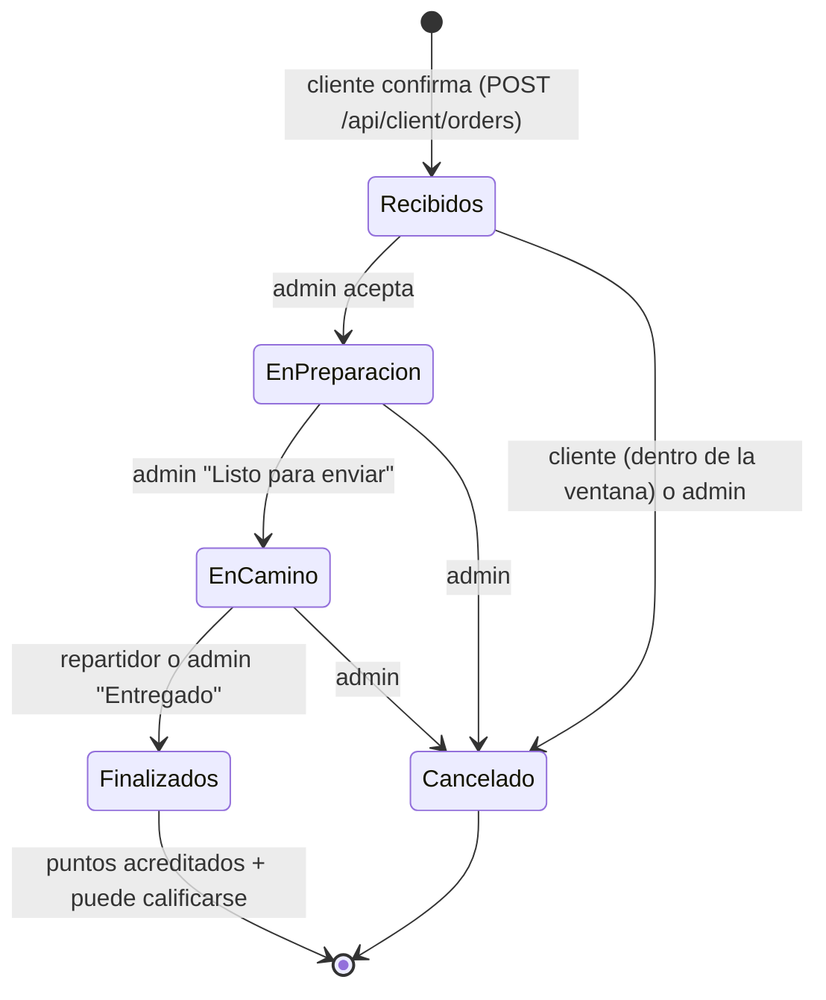

# Plan del flujo de pedido — Deli-Gastro

Documento de definición del flujo completo de delivery: quién hace qué, en qué
orden, con qué reglas y qué falta para pasarlo de demo a producción.
Estado: el flujo **funciona de punta a punta en modo demo** (ver `docs/DEMO.md`);
lo que sigue es conectarlo a los servicios reales.

## 1. Actores y portales

| Actor | Portal | Qué hace |
|---|---|---|
| Cliente | `/cliente` | Mira el menú, arma el carrito, confirma, sigue el pedido, cancela, califica, acumula y canjea puntos, chatea con el asistente |
| Admin / cocina | `/admin` | Recibe y mueve pedidos en el tablero, ve el mapa, gestiona catálogo, puntos y configuración, atiende tickets |
| Repartidor | `/repartidor` | Ve los pedidos "En Camino", toma uno, lo entrega |
| Sistema | APIs + n8n/Workers | Valida, recalcula, acredita puntos, notifica |

Cada portal es exclusivo de su rol (`app_metadata.role`: `admin`, `cliente`,
`repartidor`), forzado en `src/proxy.ts` y otra vez en cada API.

## 2. Ciclo de vida del pedido

Las transiciones válidas viven en un solo lugar (`NEXT_STATUSES` en
`src/lib/orders.ts`) y la API responde `409` ante cualquier otra.

| Transición | Quién puede |
|---|---|
| Recibidos → En Preparación | admin |
| En Preparación → En Camino | admin |
| En Camino → Finalizados | admin, o el repartidor que lo tiene asignado |
| Recibidos → Cancelado | cliente (sólo si pasaron ≤ `cancelacion_min` minutos) o admin |
| En Preparación / En Camino → Cancelado | admin |
| Tomar un pedido (asignar `courier_name`) | repartidor, sólo En Camino y sin asignar |

## 3. Paso a paso

1. **Checkout** (`/cliente/carrito`). El cliente elige dirección y forma de pago.
   El navegador manda **sólo ids y cantidades**. El servidor:
   - exige sesión de cliente y resuelve su `clients.id` (nunca se acepta un id del body);
   - rechaza si `modo_pausa` o `tienda_activa = false` (`409`);
   - rechaza si la dirección queda fuera de `radio_delivery_km` (`400`);
   - lee los productos de la base y descarta inactivos o inexistentes;
   - recalcula subtotal y **costo de envío** = `500 + km × costo_por_km`;
   - crea el pedido en "Recibidos".
2. **Tablero** (`/admin/tablero`). El pedido aparece solo (consulta cada 5 s) con
   cliente, dirección, medio de pago y aclaraciones. El admin acepta o cancela.
3. **Cocina → reparto.** "Listo para Enviar" pasa a "En Camino" y el pedido queda
   visible para los repartidores y en el mapa.
4. **Repartidor** (`/repartidor`). Toma el pedido (queda su nombre), ve dirección
   con enlace a Google Maps, teléfono y si debe **cobrar en efectivo**, y lo marca
   entregado.
5. **Entrega.** Al pasar a "Finalizados" el servidor acredita
   `floor(total / 100 × puntos_por_100)` puntos (idempotente por pedido) y
   recalcula el nivel.
6. **Seguimiento del cliente** (`/cliente/pedidos/[id]`). Línea de tiempo con
   estado, repartidor y tiempo estimado; se actualiza sola cada 4 s.
7. **Reseña.** Sólo sobre pedidos entregados y propios, una por pedido. Con 4–5
   estrellas se invita a dejar reseña en Google; con 3 o menos se abre un
   **ticket de atención** visible en el detalle del pedido (admin).
8. **Canje** (`/cliente/fidelidad`). Descuenta puntos con un movimiento negativo
   en `points_ledger`; el saldo se revalida en el servidor.

## 4. Reglas configurables (`global_config`, pantalla Configuración)

| Clave | Uso |
|---|---|
| `modo_pausa`, `tienda_activa` | Bloquea nuevos pedidos |
| `radio_delivery_km` | Zona de entrega |
| `costo_por_km` | Parte variable del envío |
| `tiempo_entrega_min` | Tiempo estimado que ve el cliente |
| `cancelacion_min` | Ventana en la que el cliente puede cancelar |
| `puntos_por_100` | Puntos ganados por cada $100 |
| `niveles_lealtad` | Umbrales de nivel (`nombre`, `desde`) |
| `horario_apertura/cierre` | Lo usa el asistente |

Pendiente de definir (no implementado): vencimiento de puntos
(`puntos_vencimiento_dias`), mínimo de canje (`puntos_minimos`), puntos de
bienvenida (`puntos_bienvenida`) y cupones reales para las recompensas — hoy un
canje sólo descuenta puntos.

## 5. Modelo de datos

Tablas: `clients`, `orders`, `points_ledger`, `global_config`, `categories`,
`products` (migraciones 001–003) y **`reviews` + columnas de entrega en `orders`
(migración `004_order_delivery_reviews.sql`, todavía sin aplicar)**.

`orders.items_desc` guarda el detalle como texto (`2x Pizza · 1x Papas`). Alcanza
para mostrar, pero no para reportes por producto: si se necesitan, el siguiente
paso es una tabla `order_items` (producto, cantidad, precio al momento).

## 6. APIs

| Ruta | Método | Rol | Función |
|---|---|---|---|
| `/api/client/orders` | GET, POST | cliente | Mis pedidos / checkout |
| `/api/client/orders/[id]` | GET, PATCH | cliente | Seguimiento / cancelar |
| `/api/client/rewards` | POST | cliente | Canjear recompensa |
| `/api/reviews` | POST | cliente | Calificar pedido entregado |
| `/api/chat` | POST | cliente | Asistente |
| `/api/orders` | GET, POST, PATCH | admin; repartidor (acotado) | Tablero, alta de mostrador, cambios de estado |
| `/api/products`, `/api/categories` | GET/POST/PATCH/DELETE | admin | Catálogo |
| `/api/config` | GET, PATCH | admin | Reglas de negocio |
| `/api/upload` | POST | admin | Imagen de producto |
| `/api/dispatch` | POST | admin | Evento hacia n8n |
| `/api/demo/*` | — | sólo modo demo | Sesión, consultas del navegador, reinicio |

Seguridad ya aplicada: roles verificados en servidor, consultas del cliente
acotadas a su `client.id`, precios y envío calculados en servidor, validación con
Zod en cada borde, límite de peticiones por IP y tipo de límite.

## 7. De demo a producción — fases

| Fase | Trabajo | Bloquea |
|---|---|---|
| **0 · Demo local** | Hecho. `npm run demo` | — |
| **1 · Supabase real** | Aplicar migración 004; alta de usuarios con fila en `clients` (registro de cliente); crear cuentas admin y repartidor con `app_metadata.role`; activar Leaked Password Protection | Dashboard Supabase |
| **2 · Imágenes (R2)** | Generar claves R2 y cargarlas en `.env.local` y Vercel | Dashboard Cloudflare |
| **3 · Notificaciones** | Deploy de Workers `pedidos-webhook` y `finanzas-sync`; flujo n8n para `new_order` / `status_update`; avisar al cliente (WhatsApp/email); notificaciones y promos de Puntos; asistente con IA real | Fase 1 |
| **4 · Tiempo real** | Reemplazar el polling por Supabase Realtime (tablero, seguimiento, repartidor) | Fase 1 |
| **5 · Dirección y pagos** | Geocodificar direcciones reales (hoy hay 5 zonas de ejemplo); cobro online con Mercado Pago | Claves externas |
| **6 · Calidad** | Tests unitarios/integración de `lib/orders*` y rutas, E2E del flujo con Playwright, cobertura ≥ 80 %, subir Next.js a ≥ 16.3.3 (advisories) | — |

## 8. Decisiones abiertas

1. **Repartidores:** ¿los asigna el admin o se autoasignan (como en el demo)?
   ¿Hace falta ubicación en vivo?
2. **Pagos:** ¿se cobra online desde el primer día o sólo efectivo/tarjeta contra entrega?
3. **Costo de envío:** ¿fórmula por distancia (actual) o zonas con precio fijo?
4. **Recompensas:** ¿cupón generado al canjear, o aplicación automática en el próximo pedido?
5. **Registro de clientes:** ¿autoservicio (email + contraseña) o por invitación?
6. **Reportes:** ¿se necesita detalle por producto (tabla `order_items`)?
